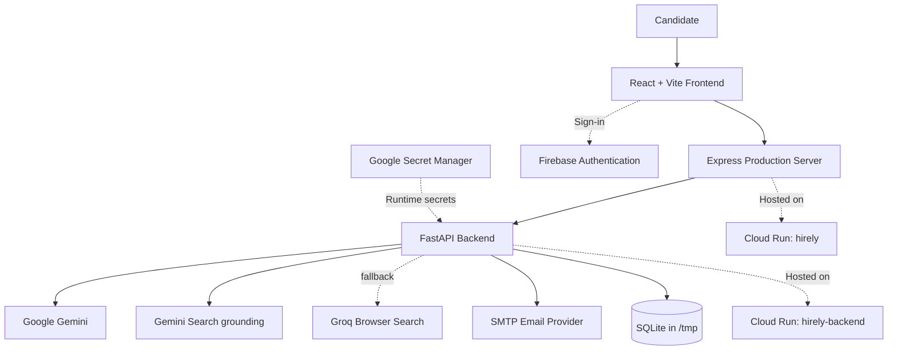

<div align="center">

# Hirely

### Your AI-Powered Career Copilot

**From opportunity discovery to career success.**

Discover relevant opportunities, understand your fit, organize your applications, and manage your job search from one intelligent workspace.

<p>
  <a href="https://hirely-871878611397.asia-south2.run.app/">
    
  </a>
  &nbsp;
  <a href="https://youtu.be/wb7zaWtM7qE">
    
  </a>
</p>

<p>
  
  
  
  
  
</p>

</div>

---

## Overview

Job searching can become a job of its own: opportunities live across different sites, evaluating fit takes time, applications are easy to lose track of, and repetitive tasks interrupt the process.

**Hirely brings the workflow together.** It is an AI-powered career copilot designed to help candidates discover opportunities, match them against their profile, track application progress, and use an AI assistant for career-related support—all in one workspace.

Built collaboratively by **Team Zenophile**, Hirely brings together AI-powered discovery, personalized career workflows, and practical application management in a single product.

> **One workspace for a more focused job search.**

## Why Hirely?

- **Discover with intent** — bring relevant job and opportunity discovery into your workflow.
- **Understand your fit** — use profile-aware matching to focus on opportunities aligned with your background.
- **Stay organized** — keep application progress visible in a central pipeline.
- **Get AI assistance** — use Hirely Core AI as a career-focused assistant.
- **Reduce repetitive work** — configure email-related updates and deadline reminders where supported.

## Key Features

| Feature | What it helps you do |
|---|---|
| **Opportunity Discovery** | Find job and career opportunities without treating every listing as equally relevant. |
| **Profile-Based Matching** | Connect your talent profile with opportunity requirements to help assess relevance. |
| **Application Pipeline** | Organize opportunities through stages such as Matched, Applied, In Review, and Offers. |
| **Hirely Core AI** | Interact with an AI assistant for career-related questions and guidance. |
| **Talent Profile & Onboarding** | Set up profile information that supports a more personalized experience. |
| **Email Automation UI** | Review digest information and configure supported deadline-alert preferences. |
| **Authentication** | Firebase Authentication supports account sign-in, including Google sign-in when configured. |

*Feature availability can depend on valid environment configuration and the status of external integrations.*

## AI-Powered Opportunity Search

Hirely uses Gemini Search grounding to find live job and internship postings, then uses Groq Browser Search as a fallback when Gemini is unavailable. Results are checked for direct posting URLs and ranked against the candidate profile. Both API keys belong in backend environment configuration and must never be committed or exposed in frontend code.

## Product at a Glance

1. **Set up your profile** to give Hirely relevant career context.
2. **Discover opportunities** and review matches.
3. **Organize your pipeline** as your application status changes.
4. **Use Hirely Core AI** for career-focused assistance.
5. **Manage updates** through the available email settings.

## Architecture

Hirely is deployed as two separate Google Cloud Run services. The frontend communicates with the FastAPI backend, which connects to the configured AI, discovery, email, authentication, and data services.



### Architecture components

- **Frontend:** React and Vite provide the application interface; an Express server serves the deployed frontend.
- **Backend:** FastAPI exposes the application’s backend functionality and coordinates integrations.
- **AI and discovery:** Gemini Search grounding is the primary live discovery provider; Groq Browser Search is the fallback.
- **Authentication:** Firebase Authentication handles supported sign-in flows.
- **Email:** SMTP configuration supports email functionality.
- **Deployment:** Google Cloud Run hosts the frontend and backend as separate services. Google Cloud Buildpacks build both services from source; the deployment does not rely on a Dockerfile.
- **Secrets:** Backend credentials are stored in Google Secret Manager and injected at runtime.

## Technology Stack

| Layer | Technology |
|---|---|
| Frontend | React, TypeScript, Vite |
| Frontend serving | Express |
| Backend API | Python, FastAPI |
| AI | Google Gemini |
| Opportunity discovery | Gemini Search grounding, Groq Browser Search |
| Authentication | Firebase Authentication |
| Email delivery | SMTP |
| Hosting | Google Cloud Run |
| Source builds | Google Cloud Buildpacks |
| Secret storage | Google Secret Manager |

## Repository Structure

The project is organized into separate frontend and backend applications.

```text
Hirely/
├── frontend/       # React + Vite user interface and production server
├── backend/        # FastAPI backend and integrations
└── README.md
```

Refer to each directory’s package/dependency and environment-example files for the exact runtime configuration.

## Run Hirely Locally

### Prerequisites

Install the following before starting:

- Git
- Node.js and npm (use a version compatible with `frontend/package.json`)
- Python (use a version compatible with the backend dependencies)
- Firebase project configuration if you want to test authentication
- API credentials for the integrations you intend to use

### 1. Clone the repository

```bash
git clone https://github.com/aryanbhardwaj03/Hirely.git
cd Hirely
```

### 2. Configure the backend

```bash
cd backend
```

Create a local `.env` file using the environment example provided in `backend/`, if present. Fill in the credentials needed for the features you want to run locally. Do not commit `.env`.

Install the backend dependencies using the repository’s dependency file. For a `requirements.txt` setup, the commands are typically:

```bash
python -m venv .venv
```

Activate the environment:

**Windows Command Prompt**
```bat
.venv\Scripts\activate
```

**macOS / Linux**
```bash
source .venv/bin/activate
```

Then install dependencies:

```bash
pip install -r requirements.txt
```

Start the backend using the application’s configured FastAPI entry point. If the entry-point module is `main.py` and exports `app`, the usual development command is:

```bash
uvicorn main:app --reload --host 127.0.0.1 --port 8000
```

If your entry-point filename or application variable differs, use the matching module path from the backend source.

### 3. Configure the frontend

Open a **second terminal** and navigate to the frontend:

```bash
cd Hirely/frontend
npm install
```

Create `frontend/.env` using the frontend environment example, if present. Set the API base URL to your local backend address, following the variable name used by the codebase. The deployed build uses `VITE_API_BASE_URL`; local development should point it at your local backend.

For example, if your local backend runs on port `8000`:

```env
VITE_API_BASE_URL=http://127.0.0.1:8000
```

Also provide the public Firebase web configuration if authentication is enabled locally. Use the exact variable names expected by the frontend source.

Start the frontend:

```bash
npm run dev
```

Open the local URL printed by Vite in the terminal (commonly `http://localhost:5173`).

> **Important:** The backend command above assumes `main:app`. Verify the actual FastAPI entry point in `backend/` before running it. Follow the repository’s environment-example files for exact variable names and required values.

## Environment Configuration

Hirely relies on environment-based configuration so local development and production can use different service endpoints and credentials.

### Backend

Depending on the features you enable, configure the backend values expected by the codebase, including:

- Gemini API credentials.
- Gemini and Groq API credentials.
- SMTP host, port, username, password/app password, and sender settings.
- Database connection or path.
- Any other backend integration settings documented in the backend environment example.

### Frontend

- `VITE_API_BASE_URL` — the API base URL embedded into the frontend at build time.
- Public Firebase web configuration — used by the frontend for Firebase Authentication.

Use the exact variable names shown in the repository’s environment examples and source. Names can differ between services or versions.

**Never commit API keys, SMTP credentials, Firebase service-account credentials, or other secrets.** Local secrets belong in ignored `.env` files. Production backend secrets are managed with Google Secret Manager.

## Production Deployment

Hirely is deployed on **Google Cloud Run** in the `asia-south2` region.

| Service | Role |
|---|---|
| [`hirely`](https://hirely-871878611397.asia-south2.run.app/) | Public React + Vite frontend, served by Express |
| `hirely-backend` | FastAPI backend and integrations |

### Deployment approach

- Both services are built from source using **Google Cloud Buildpacks**; no Dockerfile is used.
- The backend uses a `Procfile` to define its production startup process.
- Frontend API and public Firebase configuration are supplied at build time.
- Backend credentials are injected from Google Secret Manager as environment variables.
- The Cloud Run frontend domain is configured in Firebase Authentication’s Authorized domains for supported sign-in flows.
- Runtime configuration replaces hardcoded local API URLs.

### Deployment outline

1. Select the intended Google Cloud project and region.
2. Configure required backend secrets in Secret Manager.
3. Deploy the backend from the `backend/` source directory with Cloud Run source deployment.
4. Configure the frontend build-time API URL to point to the deployed backend.
5. Deploy the frontend from the `frontend/` source directory.
6. Verify authentication, API connectivity, integrations, and logs on the deployed app.

For exact `gcloud` flags and required environment-variable names, use the current deployment configuration and the Google Cloud Run documentation: [Deploy from source](https://cloud.google.com/run/docs/deploying-source-code).

## Current Limitation & Roadmap

### Database persistence

The current backend uses **SQLite in `/tmp`**. This is suitable for a lightweight deployment/demo, but `/tmp` is ephemeral: data can be lost when a Cloud Run instance is replaced or restarted, and local instance storage is not a shared durable database across scaled instances.

**Next infrastructure upgrade:** move persistent application data to a managed database such as Cloud SQL or Firestore, after selecting the storage model that best fits the application.

Other potential improvements should be prioritized based on product needs and verified in the issue tracker rather than presented as already implemented.

## Security Notes

- Keep private credentials out of source control and frontend bundles.
- Use Google Secret Manager for production backend secrets.
- Treat `VITE_*` values as public: they are embedded into the client build and must never contain private API keys.
- Configure Firebase Authorized domains and backend CORS for the intended deployed origins.
- Use durable managed storage before relying on persistent user data in production.

## Contributing

Contributions and thoughtful feedback are welcome.

1. Fork the repository.
2. Create a focused branch for your change.
3. Make and test the change locally.
4. Open a pull request describing the problem, solution, and relevant testing.

Please avoid committing credentials, local databases, generated build output, or environment files containing secrets.

## Acknowledgements

Hirely is built with the help of the open-source ecosystem and the services it integrates with, including React, Vite, FastAPI, Firebase, Google Gemini, Groq, and Google Cloud Run.

---

<div align="center">

### Make your next career move with more clarity.

<sub>Built by Team Zenophile to make the job search feel a little less scattered—and a lot more intentional.</sub>

</div>
